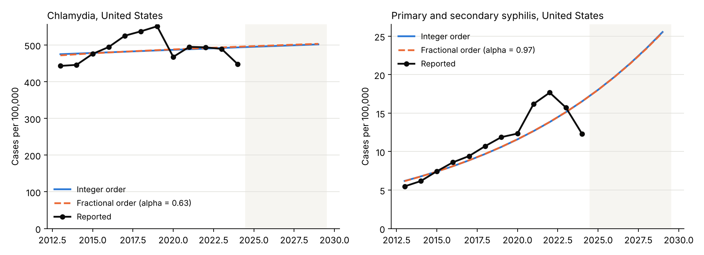

# Fractional-order transmission models for chlamydia and syphilis in U.S. states: a working prototype and first backtest

Joseph Egbemhenghe. Draft of 18 November 2026.

## Summary

This report describes a working software prototype that fits compartmental
transmission models to state-level CDC surveillance counts of chlamydia and
primary and secondary (P&S) syphilis, forecasts case rates, and simulates
changes in treatment and contact rates. It also reports a first out-of-sample
test.

The pipeline runs end to end for 50 states, DC and the national total. The
forecasts are not yet competitive. Over 2020 to 2024 the models were less
accurate than a forecast that repeats the last observed year, and the
fractional-order version performed about the same as the integer-order one.
Sections 5 and 6 explain why and what would have to change.

## 1. Data

Case counts come from the CDC National Notifiable Diseases Surveillance System
(NNDSS) weekly tables published on data.cdc.gov. A weekly table reports the
current year to date and the previous year through the same week. The
current-year column is provisional. For 2023, the week 52 national chlamydia
count was 1,482,082, while the same year read from the following year's table
was 1,648,444. The pipeline therefore takes each year's count from the
previous-year column of the final week of the next year's table.

Population denominators are U.S. Census Bureau 1 July state estimates
(Vintage 2020 for 2013 to 2019, Vintage 2025 for 2020 onward).

National totals over the 50 states and DC:

| Year | Chlamydia | P&S syphilis |
|---|---|---|
| 2013 | 1,395,492 | 17,207 |
| 2014 | 1,420,137 | 19,635 |
| 2015 | 1,526,658 | 23,872 |
| 2016 | 1,598,354 | 27,814 |
| 2017 | 1,708,569 | 30,644 |
| 2018 | 1,756,855 | 35,025 |
| 2019 | 1,809,641 | 39,010 |
| 2020 | 1,551,128 | 40,922 |
| 2021 | 1,644,293 | 53,779 |
| 2022 | 1,649,584 | 59,010 |
| 2023 | 1,648,444 | 52,988 |
| 2024 | 1,516,855 | 41,723 |

The 2013 total omits DC and the 2024 total omits Hawaii, because the source
tables have no value for them. These counts should be checked against CDC's
finalized annual STI Surveillance report tables before they are cited.

## 2. Models

All compartments are fractions of the population and rates are per year.

**Chlamydia.** The S-E-V-I-T-R model of Egbemhenghe, Akor, Atokolo and Amos
(2025), doi:10.5281/zenodo.14716850, equations (5) and (6): susceptible,
exposed, vaccinated, infected, on treatment, recovered, with force of
infection (beta1 I + beta2 T)/N. For U.S. use the vaccination rate is zero,
beta2 is zero and disease-induced death rates are zero.

**Syphilis.** Susceptible, incubating, primary, secondary, early latent and
treated compartments. Primary and secondary cases transmit. Early latent
cases can revert to secondary. Reported P&S cases are the flow of primary and
secondary cases into treatment.

**Fractional order.** Each system is written with a Caputo derivative of order
alpha between 0.6 and 1 and solved with the fractional
Adams-Bashforth-Moulton predictor-corrector method (Diethelm, Ford and Freed,
2002), step 0.02 years. With alpha = 1 the method reduces to the classical
second-order scheme, so both versions share one code path. The solver
reproduces the Mittag-Leffler solution of the linear test equation to within
0.002 (see `tests/`).

**Fixed rates.** Chlamydia: exposed to infected 12, treatment to recovered 12,
recovered to susceptible 12, turnover 0.02. Syphilis: incubating to primary
12, primary to secondary 8, secondary to early latent 3.4, reversion 0.5,
early latent to late 1, latent treatment 1, return to susceptible 0.2. These
are working values chosen for the prototype and still need literature
sources.

## 3. Fitting

Three quantities are fitted per state and infection: the contact rate, the
diagnosis-and-treatment rate, and initial prevalence. The fractional version
also fits alpha, starting from the integer-order solution. Fitting is bounded
nonlinear least squares on relative errors of annual reported rates, with a
two-year burn-in before the first observation.

National fits on 2013 to 2024:

| Infection | Version | alpha | Relative RMSE |
|---|---|---|---|
| Chlamydia | integer | 1.00 | 6.7% |
| Chlamydia | fractional | 0.63 | 6.7% |
| P&S syphilis | integer | 1.00 | 15.0% |
| P&S syphilis | fractional | 0.97 | 14.9% |

## 4. Backtest design

For each of 51 areas, each infection and each origin year T in 2019, 2020,
2021 and 2022, the models were fitted to data through T and used to forecast
T+1 and T+2. Two reference forecasts were added: persistence (the last
observed rate) and a straight line through the last five training years.
The score is absolute percentage error. This gives 204 one-year and 203
two-year forecasts per infection and forecaster.

## 5. Results

Median absolute percentage error across states:

| Forecaster | Chlamydia, 1 yr | Chlamydia, 2 yr | Syphilis, 1 yr | Syphilis, 2 yr |
|---|---|---|---|---|
| Model, integer order | 11.2% | 17.4% | 21.6% | 33.2% |
| Model, fractional order | 11.1% | 17.0% | 21.4% | 33.1% |
| Persistence | 6.0% | 8.9% | 17.0% | 30.1% |
| Five-year trend | 7.6% | 10.4% | 19.7% | 32.5% |

Three findings.

1. Persistence was the most accurate forecaster in all four columns.
2. The fractional-order model had a lower error than the integer-order model
   in 63% of chlamydia forecasts and 52% of syphilis forecasts, but the median
   difference was under 0.05 percentage points. This test does not show a
   meaningful accuracy gain from the fractional order.
3. In 81% of backtest fits the fitted alpha stayed at 0.9 or above, close to
   its starting value. Annual data carry little information about alpha.

The syphilis model did better than persistence at the national level for
origins 2019 and 2020, when cases were still rising steadily, and much worse
for origin 2022, when it projected continued growth into the 2023 and 2024
decline.

## 6. Limitations

- Twelve annual points per state are few for models with three or four free
  parameters.
- Rates are constant in time. The models cannot represent the 2020 reporting
  drop or the syphilis downturn after 2022.
- The fitted models sit near the epidemic threshold, so scenario results are
  very sensitive. In some states a 50% faster treatment rate drives modelled
  cases to zero within four years. That is a property of the fit, not a
  credible prediction.
- Reported cases are treated as all infections. Undiagnosed infection and
  changes in screening volume are not modelled.
- There is no sex, age or sexual-network structure.
- There are no uncertainty intervals.
- The Caputo derivative is applied without rescaling the rate constants, so
  parameter units differ between the two versions.
- No machine-learning component has been built. Parameter estimation here is
  ordinary numerical optimization.
- National Inpatient Sample data are not used.

## 7. Next steps

See `ROADMAP.md`. The changes most likely to matter are longer and
finer-grained data (finalized CDC series back to 2000, county level, by sex),
time-varying contact and screening rates, and a hierarchical fit that shares
information across states.

## References

- Diethelm K, Ford NJ, Freed AD (2002). A predictor-corrector approach for the
  numerical solution of fractional differential equations. *Nonlinear
  Dynamics* 29, 3-22.
- Egbemhenghe J, Akor LF, Atokolo W, Amos J (2025). Numerical Solution of
  Fractional order Chlamydia Model Via the Generalized Fractional
  Adams-Bashforth-Moulton Approach. *GPH - International Journal of
  Mathematics* 8(01), 1-23. doi:10.5281/zenodo.14716850
- CDC. NNDSS weekly tables, data.cdc.gov. Dataset ids in `data/SOURCES.json`.
- U.S. Census Bureau. State population totals, Vintage 2020 and Vintage 2025.
