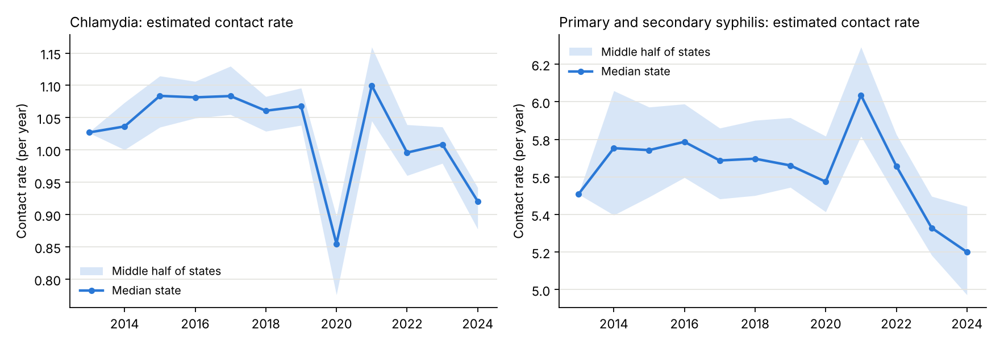
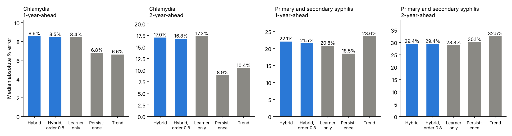

# A hybrid transmission-model and machine-learning forecaster for chlamydia and syphilis in U.S. states: prototype and backtest

Joseph Egbemhenghe. Draft of 18 November 2026. Version 2.

## Summary

This prototype implements, in working code, the four parts of the proposed
framework: a multi-stage transmission model, a fractional-order formulation,
estimation of model parameters from surveillance data, and a machine-learned
forecast of those parameters. It produces state forecasts with error bands,
a ranking of states, scenarios, and an allocation exercise.

Tested on 2020 to 2024, the combined forecaster is clearly better than the
transmission model with a constant contact rate. It does not beat the rule
"next year equals this year" for chlamydia or for syphilis one year ahead,
and is about level with it for syphilis two years ahead. The fractional order
makes almost no difference to accuracy on annual data. The framework is
built and measurable; it has not yet shown a forecasting advantage.

## 1. Data

Case counts: CDC National Notifiable Diseases Surveillance System (NNDSS)
weekly tables on data.cdc.gov, 2013 to 2024, 50 states and DC. Each year's
count is read from the previous-year column of the final week of the
following year's table, which includes late reports. For 2023 the national
chlamydia count read this way is 1,648,444; the provisional week 52 figure
was 1,482,082. DC has no 2013 value and Hawaii no 2024 value. Population:
U.S. Census Bureau 1 July estimates.

| Year | Chlamydia | P&S syphilis |
|---|---|---|
| 2013 | 1,395,492 | 17,207 |
| 2014 | 1,420,137 | 19,635 |
| 2015 | 1,526,658 | 23,872 |
| 2016 | 1,598,354 | 27,814 |
| 2017 | 1,708,569 | 30,644 |
| 2018 | 1,756,855 | 35,025 |
| 2019 | 1,809,641 | 39,010 |
| 2020 | 1,551,128 | 40,922 |
| 2021 | 1,644,293 | 53,779 |
| 2022 | 1,649,584 | 59,010 |
| 2023 | 1,648,444 | 52,988 |
| 2024 | 1,516,855 | 41,723 |

These should be checked against CDC's finalized annual report tables before
they are cited. National Inpatient Sample data are not used.

## 2. Method

**Transmission models.** Chlamydia: susceptible, exposed, infected, on
treatment, recovered, with reinfection. Syphilis: susceptible, incubating,
primary, secondary, early latent, treated; primary and secondary cases
transmit, early latent cases can revert to secondary, and reported P&S cases
are primary and secondary cases entering treatment. Compartments are
population fractions and rates are per year. Fixed rates are listed in
`stimodel/models.py`; they are working values that still need sources.

**Fractional order.** Each system is written with a Caputo derivative of
order alpha and solved with the fractional Adams-Bashforth-Moulton
predictor-corrector scheme (Diethelm, Ford and Freed, 2002), 50 steps per
year. Results are reported for alpha = 1.0 and alpha = 0.8. The solver
reproduces the Mittag-Leffler solution of the linear test equation to within
0.002.

**Data assimilation.** The contact rate is not a fitted constant. For each
state and each year it is the value that carries the model from the state it
had reached to the next year's reported rate (annual rates are treated as
mid-year reporting rates). This gives a contact-rate series per state. An
earlier attempt that matched whole-year integrals was numerically unstable:
the estimates alternated high and low with growing amplitude.

**Learned parameter forecast.** A gradient-boosted regression model, one per
infection and trained on all states together, predicts how far next year's
contact rate will depart from the "stationary" rate, the one that would hold
reported cases level. Inputs: the state's last two yearly changes, its level
against other states, national and regional change, and case volume. A
prediction of zero is therefore "no change". National change is the most
used input (66% of split importance for chlamydia, 46% for syphilis).

**Forecast.** The learned contact rate drives the transmission model forward.

## 3. Backtest

Origins 2019 to 2023. At each origin the learner is trained on data up to
that year only. Forecasts one and two years ahead are scored for every state
with a reported value (254 one-year and 203 two-year forecasts per
infection). Median absolute percentage error:

| Forecaster | Chlamydia, 1 yr | Chlamydia, 2 yr | Syphilis, 1 yr | Syphilis, 2 yr |
|---|---|---|---|---|
| Transmission model + learned contact rate, alpha 1.0 | 8.6% | 17.0% | 22.1% | 29.4% |
| Same, alpha 0.8 | 8.5% | 16.8% | 21.5% | 29.4% |
| Transmission model, contact rate held constant, alpha 1.0 | 12.5% | 20.3% | 21.7% | 52.4% |
| Same, alpha 0.8 | 10.8% | 15.9% | 22.0% | 47.3% |
| Learner on reported rates, no transmission model | 8.4% | 17.3% | 20.8% | 28.8% |
| Next year equals this year | 6.8% | 8.9% | 18.5% | 30.1% |
| Five-year straight line | 6.6% | 10.4% | 23.6% | 32.5% |

What the table shows:

1. Adding the learner to the transmission model cut its error in three of
   four columns, and by almost half for syphilis two years ahead.
2. The combined forecaster was more accurate than "next year equals this
   year" in 28% of chlamydia forecasts and 47% of syphilis forecasts.
3. The combined forecaster and the learner without a transmission model
   score within 1.3 percentage points of each other. On this data the
   transmission model adds structure for scenarios but not accuracy.
4. Alpha 0.8 beat alpha 1.0 in 56% of chlamydia and 52% of syphilis
   forecasts, with a median difference under 0.1 percentage points. With the
   contact rate held constant the gap is larger and favours alpha 0.8 in
   three columns.
5. Errors are largest where the trend turned: forecasts made from 2019
   (before the 2020 reporting drop) and syphilis forecasts made from 2022 and
   2023 (before and during the decline).

A first formulation, in which the learner predicted the year-on-year change
in the contact rate directly, scored 8.1%, 15.6%, 24.8% and 50.8% at alpha
1.0. The formulation above replaced it after that result. Both were scored
on the same years, so the improvement is not an independent confirmation.

## 4. Forecasts and error bands

Five-year forecasts start from 2024. The population-weighted national
forecast for 2026 is 463 chlamydia cases per 100,000 (448 reported in 2024)
and 8.7 P&S syphilis cases per 100,000 (12.3 in 2024).

Error bands come from the backtest: the range that held 80% of past
forecast-to-outcome ratios at each horizon. When each origin was held out in
turn, the bands covered 69% and 78% of chlamydia outcomes (one and two years)
and 68% and 67% of syphilis outcomes. They are too narrow. Past forecasts
also ran high, so the bands sit mostly below the central forecast.

## 5. Scenarios and allocation

Scenarios scale the diagnosis-and-treatment rate (10, 20, 30% faster) or the
contact rate (5, 10% lower) from 2025. The models sit close to the epidemic
threshold, so modest changes produce large modelled effects: in Texas a 30%
faster treatment rate lowers modelled P&S syphilis by 96% by 2029. These
magnitudes are not credible and are shown as direction only.

The allocation exercise gives each state between 0 and 30% extra
treatment capacity under a fixed budget, with cost assumed proportional to
caseload. Targeting averts 0.5% more modelled chlamydia cases and 1.4% more
syphilis cases than an even 10% everywhere. Under these assumptions targeting
by state makes little difference.

## 6. Limitations

- Twelve annual points per state. The learner has a few hundred training rows.
- No sex, age or sexual-network structure, and no separation of screening
  volume from true incidence. Reported cases are treated as all infections.
- The 2020 reporting drop is in the training data with no special handling.
- Fixed rates are unsourced working values.
- Scenario magnitudes are unreliable, as described above.
- Error bands under-cover.
- The Caputo derivative is applied without rescaling rate constants.
- State-level only. No county data, no congenital syphilis, no NIS data.
- The model formulation was revised once after seeing backtest results.

## References

- Diethelm K, Ford NJ, Freed AD (2002). A predictor-corrector approach for the
  numerical solution of fractional differential equations. *Nonlinear
  Dynamics* 29, 3-22.
- Egbemhenghe J, Akor LF, Atokolo W, Amos J (2025). Numerical Solution of
  Fractional order Chlamydia Model Via the Generalized Fractional
  Adams-Bashforth-Moulton Approach. *GPH - International Journal of
  Mathematics* 8(01), 1-23. doi:10.5281/zenodo.14716850
- CDC. NNDSS weekly tables, data.cdc.gov. Dataset ids in `data/SOURCES.json`.
- U.S. Census Bureau. State population totals, Vintage 2020 and Vintage 2025.
